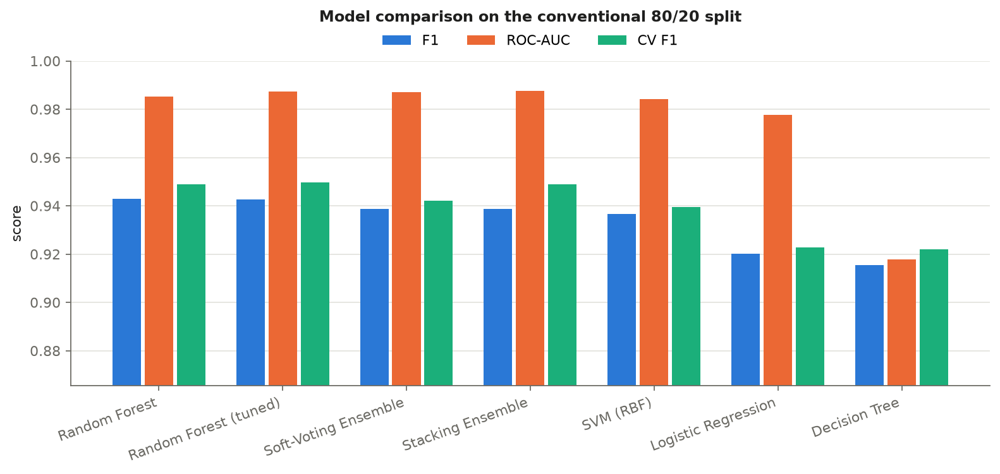
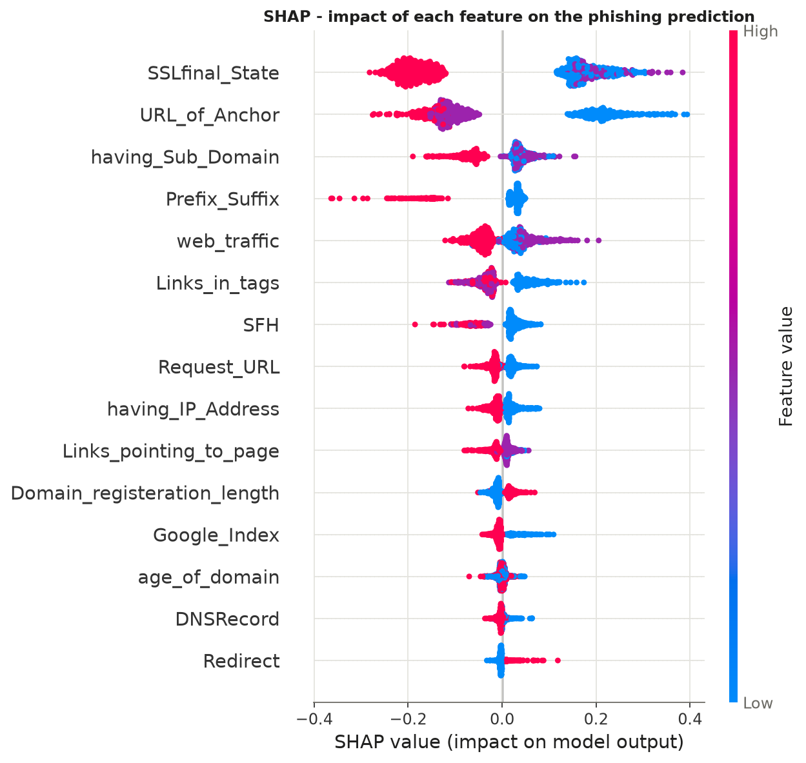
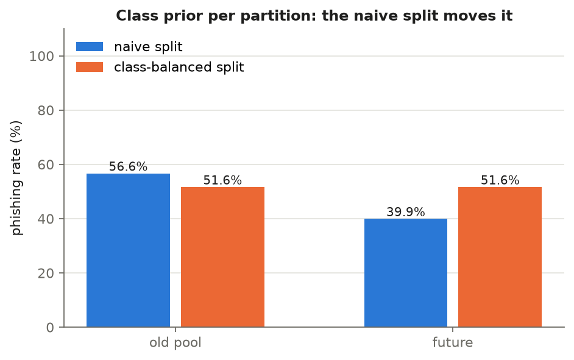
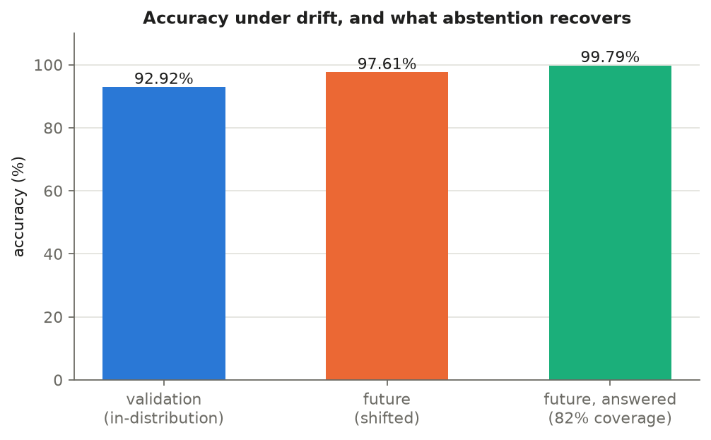
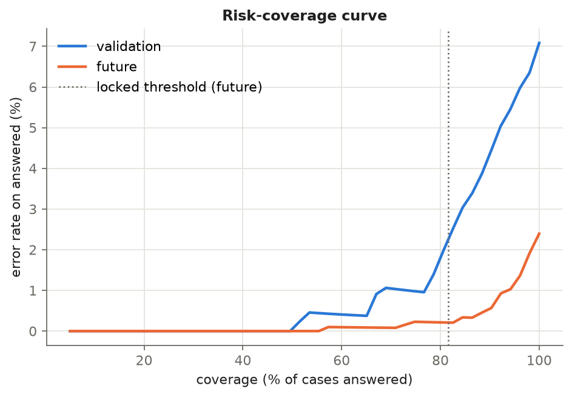
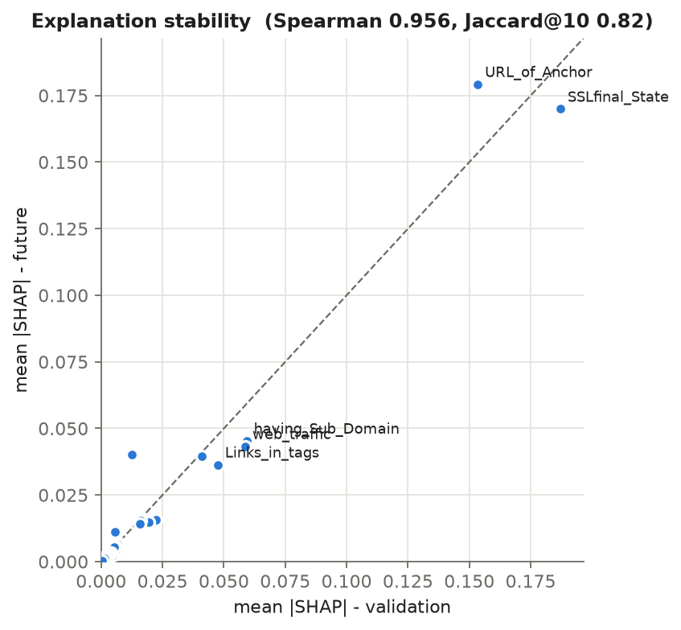

# Explainable Phishing Detection Under Distribution Shift

**Hybrid ensembles, calibration, and selective prediction on the UCI Phishing Websites dataset**

  

Most phishing-detection papers on the UCI dataset report 95-97% accuracy from a random train/test split and stop there. That number says little about deployment, where the sites a detector sees tomorrow are not drawn from the same distribution as the sites it was trained on. This project does the conventional study first, then asks what happens when the data shifts: how much accuracy is lost, whether the model's confidence still means anything, whether it can recognise when to abstain, and whether its explanations stay the same.

The work was done for CSE 477 at East West University and is submitted to ECCE 2027.

## What is in here

The **static study** compares seven models on a stratified 80/20 split: Decision Tree, Random Forest, Logistic Regression, an RBF SVM, a grid-searched Random Forest, a soft-voting ensemble and a stacking ensemble (RF + LR + SVM with a logistic-regression meta-learner). Every model is scored with accuracy, precision, recall, F1, ROC-AUC, PR-AUC and 5-fold cross-validated F1, and the models are explained with impurity importance, permutation importance and SHAP.

The **drift study** simulates a future distribution, since the corpus has no timestamps. Records are ranked by atypicality (mean absolute z-score over the ten most discriminative features) and the most atypical 30% *of each class* become the "future" partition. Ranking within each class holds the class prior fixed, so the shift is covariate shift rather than label shift. A naive version that takes the top 30% overall is included only to show how it entangles the two (the phishing rate moves sharply and inflates any drift result). On the balanced split the project measures feature shift with Kolmogorov-Smirnov tests, trains a Random Forest on the old data, calibrates it with cross-fitted isotonic regression, chooses an abstention threshold on validation data and **locks it before the future partition is scored**, and compares SHAP attributions on validation and future data from the same fitted model (Spearman rank correlation, top-10 Jaccard overlap, direction flips).

## A note on label encoding

The UCI file encodes the target as `-1 = phishing` and `1 = legitimate` (4,898 phishing and 6,157 legitimate of 11,055 rows). An earlier version of this project inferred the label direction from class fractions after deduplication and got it backwards, so its precision, recall, F1 and class priors were reported for the legitimate class. This code fixes the mapping in `phishdrift/config.py` and refuses to run if the labels look inverted: valid SSL (`SSLfinal_State = 1`) must be negatively correlated with phishing, otherwise `data.check_label_direction` raises an error. The positive class everywhere in this repository is **phishing**.

## Results

The block below is written by `scripts/run_all.py` from the real dataset. Figures are in [`figures/`](figures) and every table behind them is in [`results/`](results).

<!-- RESULTS:START -->
*Run `python scripts/run_all.py` (or the Kaggle notebook) to fill this section.*
<!-- RESULTS:END -->

| | |
|---|---|
|  |  |
|  |  |
|  |  |

## How to run

**On Kaggle (easiest).** Create a new notebook, upload `notebooks/phishing_drift_full.ipynb` (*File -> Import Notebook*), add the dataset with *Add Input* (search "phishing websites dataset", for example `mmelgizin/phishing-websites-dataset`), and choose *Run All*. The notebook writes its own copy of the package, finds the CSV under `/kaggle/input` and saves `results/` and `figures/` to the output panel. It takes about 5-10 minutes on CPU.

**Locally.**

```bash
git clone https://github.com/Ashikuzzaman17/An-Explainable-Hybrid-Ensemble-Framework-for-Phish.git
cd An-Explainable-Hybrid-Ensemble-Framework-for-Phish
pip install -r requirements.txt
# put the dataset CSV (or the original .arff) in data/  - see data/README.md
python scripts/run_all.py
```

`run_all.py` accepts `--data PATH` if the file is somewhere else. After editing anything in `phishdrift/`, run `python scripts/build_notebook.py` to regenerate the notebook.

## Repository layout

```
phishdrift/
  config.py        every setting that affects a reported number
  data.py          loading, deduplication, fixed label encoding, label-direction check
  models.py        the seven models, grid search, metrics (positive class = phishing)
  drift.py         atypicality score, naive vs class-balanced split, KS tests
  abstention.py    calibration, ECE, threshold selection, selective metrics, risk-coverage
  explain.py       SHAP values and explanation-stability metrics
  plots.py         all figures
  pipeline.py      static_study() and drift_study(), shared by the script and the notebook
scripts/
  run_all.py       reproduces everything and refreshes the results block above
  build_notebook.py  regenerates the self-contained Kaggle notebook
notebooks/
  phishing_drift_full.ipynb               full self-contained pipeline (run this)
  original_static_study_kaggle_v3.ipynb   first course version, kept for history (labels inverted)
data/README.md     where to get the dataset
results/, figures/ generated outputs
```

## Limitations

The shift is simulated. Atypicality ranking is a reasonable stand-in for drift on a corpus without dates, but it is not the same as real temporal drift, and the conclusions should be confirmed on time-stamped data such as a newer crawl. The UCI features are hand-engineered and categorical (-1, 0, 1), and almost half of the raw rows are exact duplicates, so results on the deduplicated set are the honest ones. Some feature vectors appear with both labels; these are kept and represent irreducible noise.

## Citation

If you use this code, please cite the paper (under review):

```
Md Ashikuzzaman et al. "Explainable Phishing Detection Under Distribution Shift:
Hybrid Ensembles, Calibration, and Selective Prediction." Submitted to ECCE 2027.
```

The dataset is from Mohammad, Thabtah and McCluskey, *Phishing Websites*, UCI Machine Learning Repository, 2012 (https://doi.org/10.24432/C51W2X).

## License

MIT - see [LICENSE](LICENSE).
